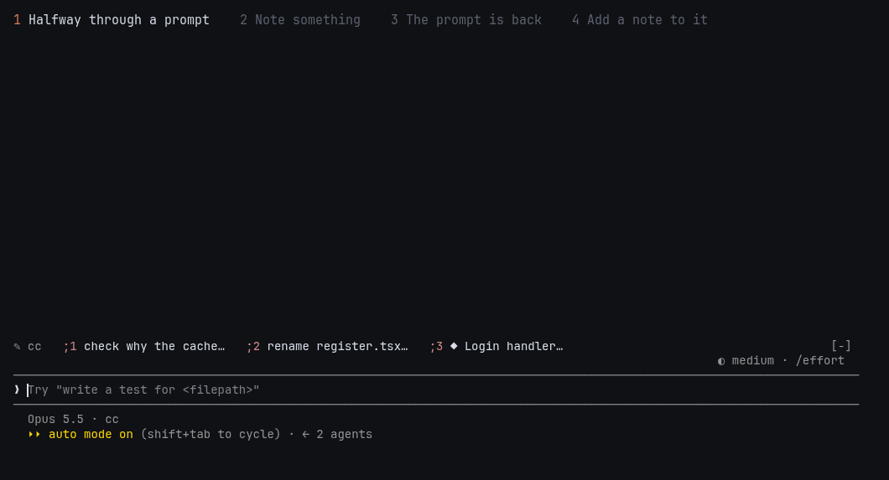
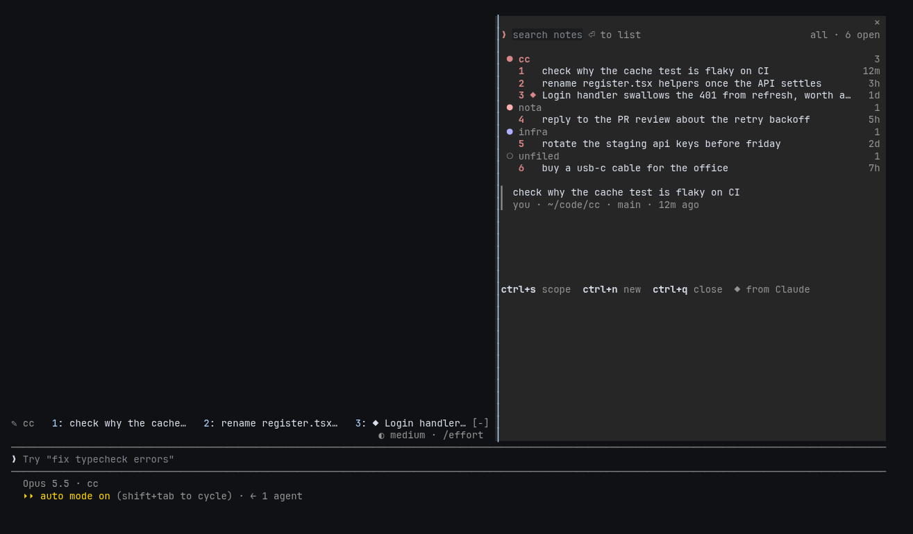
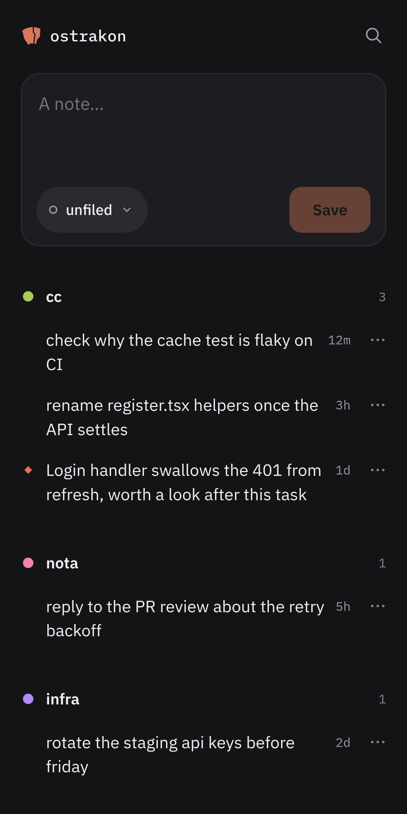

<h1>
  <picture>
    <source media="(prefers-color-scheme: dark)" srcset="brand/lockup-dark.svg">
    
  </picture>
</h1>

A scratchpad for Claude Code. Halfway through a prompt, something else comes to mind: open the pane, note it, close the pane, and your prompt is back as you left it. Later, pull the note into the prompt when you get to it. Claude can jot notes for you too.

In the demo: note something mid-prompt, then add a saved note to the prompt.

<picture>
  <source media="(prefers-reduced-motion: reduce)" srcset="docs/images/demo.png">
  
</picture>

Notes are kept per project, and the pane shows all of them. Syncing between machines and a phone app are optional.

## What it does

- **Capture** a note in under two seconds, even while Claude is working. Mid-prompt, `ctrl+x s` opens the pane and `ctrl+n` starts a note; close the pane and your draft is back. In an empty prompt, `/jot text` or `//` saves one without opening anything.
- **Gives Claude a `jot` tool**: Claude jots notes it thinks are important or wants to pass on to you. You can also ask it to add one: "jot that down". Claude can also list your notes and archive one once it's done.
- **Triage** open notes across all your projects in a searchable pane: edit, move, archive, bundle several into one prompt.
- **Dispatch** a note into the prompt. This project's open notes sit in a row of numbered chips above the prompt (the "pocket"); type `;` and a note's number (`;2`) in an empty prompt to pull it in. A lone number is left alone, so it still answers Claude's numbered questions. Mid-prompt, find the note in the pane and press `t`: it goes in under what you've typed.
- **Harvest** (opt-in): after each turn, an extra review looks for side issues that came up and offers them as notes, which you keep or dismiss. It doesn't change what Claude is doing.
- **Sync**: two-way sync enabled by multiple methods. Through a small hub, a plain folder, Obsidian or a combination of methods ([Sync](#sync)).
- **Phone**: capture and triage from your phone with the hub's web app, installed to the Home Screen, or send a note from the share sheet or Siri with an iOS Shortcut.

Notes are plain Markdown files with some YAML. One per note, in `~/.local/share/ostrakon/` by default, so they are yours to read, grep and back up.



## Sync

Sync is optional and works both ways. Add, edit, move or archive a note on one machine or on your phone, and the change shows up everywhere else. If the same note changes in two places, the later change wins everywhere. There are a few ways to sync; use one or combine them:

- **The hub** (`server/`): a small service you run on one of your machines. Your other machines and your phone reach it over Tailscale (the easy option) or your own HTTPS proxy, tunnel or VPN. Changes show up in other sessions within seconds, and the hub also serves the phone app. Setup: [the hub and the phone app](#the-hub-and-the-phone-app-optional).
- **A folder** (the `mirrorDir` option): ostrakon keeps a copy of your notes in a folder, and whatever syncs that folder (Dropbox, Syncthing, any synced drive) carries them between machines. Point it at an Obsidian vault and you can edit notes there too; your edits come back. Obsidian shows each note's metadata as Properties at the top; to hide them, set Settings → Editor → Properties in document to Hidden. No server needed.
- **Both at once**: they work independently, so you can use the hub for your phone and a folder for Obsidian.

**On your phone**, the hub's web app installs to the Home Screen and opens straight to a note field. You can triage there too (edit, move, archive, mark sent), and anything you capture offline is kept until the hub is reachable again. To pair a phone, scan the QR code that `ostrakon pair` shows. An iOS Shortcut can send a note from the share sheet or Siri without opening the app. Details: [`docs/phone.md`](docs/phone.md).

<p align="center"></p>

## Install

There are two ways to install it:

- **The install script** gets you the mod and the `ostrakon` command: `update`, `doctor`, `pair`, and the hub for syncing and the phone app. Updates come through `ostrakon update`.
- **Claude Code's plugin marketplace** gets you the mod only. There's no `ostrakon` command, so you can't run the hub or pair a phone from it; folder sync, and a hub set up on another machine, still work. Updates come through Claude Code.

Use one or the other. The install script offers to add the [keybindings](#keybindings); with the marketplace, add them yourself.

### Requirements

- **Claude Code** with mods support (see the [mods docs](https://code.claude.com/docs/en/plugins/mods/overview)). Tested with 2.1.296; mods are still changing, so a much older or newer version may not work.
- **git**, and **python3** for the install script (without it, the script tells you the one line to add yourself).
- **For the hub:** [Bun](https://bun.sh) (tested with 1.4.3) to run the hub and to use `ostrakon pair`, and `qrencode` for the pairing QR code. `install.sh --hub` sets the hub up as a systemd service, so that part is Linux-only for now; elsewhere, run `ostrakon hub` however you like to keep things running.

Tested on Linux. macOS should work for the mod but hasn't been tried yet; reports are welcome.

### With the install script

One command clones ostrakon into `~/.local/share/ostrakon-src` and installs the newest release:

```sh
curl -fsSL https://raw.githubusercontent.com/gaius-codius/ostrakon/main/get.sh | bash
```

Add `-s -- --hub` after `bash` to set up the hub too, or `-s -- --main` to follow the newest code on `main` instead of releases. Running it again updates what's there. To read the script before running it: `curl -fsSL https://raw.githubusercontent.com/gaius-codius/ostrakon/main/get.sh -o get.sh`, look it over, then `bash get.sh`.

Or clone the repo wherever you like and run the install script yourself:

```sh
git clone https://github.com/gaius-codius/ostrakon.git
cd ostrakon && ./install.sh --release
```

Either way, the install script:

- switches to the newest [release](https://github.com/gaius-codius/ostrakon/releases) (leave out `--release` to run what's on `main`),
- loads the mod in every Claude Code session, by setting `CLAUDE_CODE_PLUGIN_DIRS` in `~/.claude/settings.json` (only if it isn't set already, and it keeps a `.bak` copy),
- and adds the `ostrakon` command to `~/.local/bin`.

It's safe to run again. `./install.sh --hub` also sets up the hub (below).

To try it without installing anything, load it for a single session: `claude --plugin-dir ostrakon/plugin`. To install by hand, add the folder to `~/.claude/settings.json`:

```json
{ "env": { "CLAUDE_CODE_PLUGIN_DIRS": "/path/to/ostrakon/plugin" } }
```

### From the plugin marketplace

```sh
claude plugin marketplace add gaius-codius/ostrakon
claude plugin install ostrakon@ostrakon
```

Update it with `claude plugin update ostrakon@ostrakon`, or turn on auto-update for the marketplace in `/plugin`. A new copy arrives with each release. If you also run the install script, it sees the plugin and doesn't load the mod a second time.

### Updating

```sh
ostrakon update             # or ./update.sh in the repo
ostrakon update --main      # switch to the newest code on main instead of releases
ostrakon update --release   # switch back to releases
ostrakon version
```

If you installed a release, `update` moves you to the newest one; if you're on a branch, it pulls that branch (and stops rather than touch commits of your own). It restarts the hub if it's running and lists what changed. Restart any open Claude Code sessions to pick up the new version. Each release's changes are in [`CHANGELOG.md`](CHANGELOG.md).

### If something isn't working

```sh
ostrakon doctor
```

It checks that the mod loads, which Claude Code version last ran it and whether anything went wrong there, your notes folder, the hub and its token, and the tools ostrakon needs, and says what to fix. It changes nothing and never prints your token, so its output is safe to paste into a bug report.

### Keybindings

A mod can't add keyboard shortcuts of its own, so ostrakon borrows some existing Claude Code actions (which is why the names below look unrelated). The install script asks whether to add these to `~/.claude/keybindings.json` (`--keys` adds them without asking, `--no-keys` skips them). It leaves alone any key you've bound to something else, and any of these actions you've already given a key. To add them by hand:

```json
{
  "bindings": [
    { "context": "Chat", "bindings": { "ctrl+x s": "app:cycleDiffBase" } },
    {
      "context": "Pane",
      "bindings": {
        "ctrl+x s": "app:cycleDiffBase", "ctrl+q": "pane:previous", "ctrl+f": "app:toggleDiffNoiseFilter",
        "ctrl+s": "app:toggleDiffPreSession", "ctrl+n": "pane:next"
      }
    },
    {
      "context": "PaneField",
      "bindings": {
        "ctrl+x s": "app:cycleDiffBase", "ctrl+q": "pane:previous", "ctrl+f": "app:toggleDiffNoiseFilter",
        "ctrl+s": "app:toggleDiffPreSession", "ctrl+n": "pane:next"
      }
    }
  ]
}
```

`ctrl+x s` opens and closes the pane; the other keys work inside it. `/jot` and `//` need no setup. The full key list is in [`docs/SPEC.md`](docs/SPEC.md) §4.

## Configuration

Set these under the plugin's options (`pluginConfigs.ostrakon.options` in your settings, or `pluginConfigs["ostrakon@ostrakon"].options` if you installed it with `claude plugin install`):

| Option | Default | What it does |
|---|---|---|
| `notesDir` | `~/.local/share/ostrakon` | Where notes are stored. The `OSTRAKON_DIR` environment variable overrides it. |
| `pocket` / `pocketMax` | on / 5 | The numbered chips above the prompt, and how many show. |
| `harvest` | off | Review each finished turn for side issues worth keeping. |
| `harvestMode` | `fork` | `fork` reviews the whole conversation, tool output included, so it sees more but costs more as the conversation grows. `light` has a small model read only your prompt and Claude's final answer: much cheaper, but it misses more. |
| `harvestMaxPerTurn` | 3 | The most notes harvest offers after one turn. |
| `hubUrl` / `hubToken` | empty | The hub to sync with, and its token. Empty: no hub. |
| `mirrorDir` | empty | A folder to keep a synced copy of your notes in, such as a Dropbox or Syncthing folder or part of an Obsidian vault. |

## The hub and the phone app (optional)

The hub is a single [Bun](https://bun.sh) file (`server/hub.ts`) that stores notes in SQLite. It only listens on the machine it runs on and needs a token for every request, so you choose how other devices reach it. We use Tailscale, the simplest option: `tailscale serve` gives it an HTTPS address only your devices can reach, and `install.sh` and `ostrakon pair` set it up for you.

```sh
./install.sh --hub
```

This creates a token in `~/.config/ostrakon-hub/env` (if there isn't one yet) and installs and starts the hub as a systemd user service (`server/ostrakon-hub.service`). It then prints the two steps left for you: `loginctl enable-linger`, so the hub keeps running when you log out, and `tailscale serve`, to put it on your tailnet.

To pair a phone, run `ostrakon pair` (it needs `qrencode`) and scan the QR code. The code in it works once and expires after 5 minutes, so the QR never contains the token itself; `--token` prints a link that does.

To run the hub in the foreground instead: `HUB_TOKEN=$(openssl rand -hex 24) ostrakon hub`. The `ostrakon` command reads `HUB_TOKEN` from the environment or from `~/.config/ostrakon-hub/env`.

Not using Tailscale? Any HTTPS reverse proxy, tunnel or VPN works too; see [Open it](docs/phone.md#open-it).

The service runs `~/.local/bin/ostrakon hub`, so it doesn't matter where the repo lives. Phone setup, the Home Screen app and the iOS Shortcut are covered in [`docs/phone.md`](docs/phone.md). Read [`SECURITY.md`](SECURITY.md) before making the hub reachable from other devices.

## Known limitations

These come from Claude Code's mods interface, which is still new, and should go away as it matures.

- **Long notes in the pane's text field.** When a note is longer than the capture or edit field, the text doesn't scroll with you: it disappears past the end of the field, while the cursor keeps moving and can even drop to an empty "second" line. What you type is all there, though, and the whole note shows in full just below the field as you write. It needs a text field that wraps or scrolls, which mods don't have yet.
- **Claude Code updates can break things.** Mods change between versions. If something stops working after an update, run `ostrakon doctor` and mention your Claude Code version when you report it.

More, including a couple of folder-sync edge cases, in [`ROADMAP.md`](ROADMAP.md#known-limitations).

## Development

- How it's designed, and notes on the platform it builds on: [`docs/SPEC.md`](docs/SPEC.md). How it looks: [`docs/DESIGN.md`](docs/DESIGN.md). Ideas for what's next: [`ROADMAP.md`](ROADMAP.md).
- `tools/check.sh` runs every check: `claude plugin validate`, the design check ([`docs/DESIGN.md`](docs/DESIGN.md) against the code), the type-check, `claude plugin test` and the hub's tests. The mod's tests and type-check need the `claude` CLI installed, because the mods test kit and types ship with it. CI runs the tests on the version `bin/tested-with` names.
- The hub's tests need only [Bun](https://bun.sh): `cd server && bun test`.
- How to contribute, and how releases are made: [`CONTRIBUTING.md`](CONTRIBUTING.md).
- `tools/` also has the screenshot pipeline and some experiment scripts; they write to `working-docs/`, which git ignores.

## License

[MIT](LICENSE)
